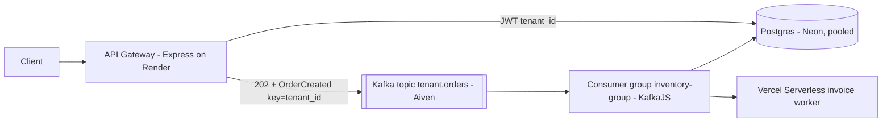

# Multi-Tenant B2B SaaS: Kafka + DB Tuning + Serverless

## Live links
- App: <PASTE RENDER URL>
- API base: <PASTE RENDER URL>/api/v1
- Serverless worker: <PASTE VERCEL URL>/api/invoice?orderId=1

## Test accounts
| Tenant | Email | Password |
|---|---|---|
| Tenant A (id 1) | a@test.com | pass123 |
| Tenant B (id 2) | b@test.com | pass123 |

## Architecture

## Multi-tenancy
Shared database with `tenant_id` discriminator. `tenant_id` is read only from the verified JWT claim in the
middleware, and every query contains `WHERE tenant_id = $1`. Tenant A can never read Tenant B rows.

## Kafka
- Topic `tenant.orders`, 3 partitions. Message key = `tenant_id` (ordering per tenant inside a partition).
- `POST /api/v1/orders` returns `202 Accepted` and publishes `OrderCreated`.
- Consumer group `inventory-group` updates stock and logs `partition / offset`.

## Benchmarks
### N+1 vs JOIN (200 orders)
| Method | Queries | Latency |
|---|---|---|
| N+1 (`/orders/slow`) | 201 | ___ ms |
| JOIN (`/orders/fast`) | 1 | ___ ms |

### EXPLAIN ANALYZE, `WHERE tenant_id=1 ORDER BY created_at DESC LIMIT 50`
| | Plan | Execution time |
|---|---|---|
| Before index | Seq Scan | ___ ms |
| After `INDEX (tenant_id, created_at DESC)` | Index Scan | ___ ms |

Screenshots: `docs/explain-before.png`, `docs/explain-after.png`

## Connection pooling
`pg.Pool` with `max: 10` (see `db.js`).

## Serverless cold vs warm
| Request # | startType | executionMs |
|---|---|---|
| 1 | COLD | ___ |
| 2 | WARM | ___ |
| 3 | WARM | ___ |
Cold start is slower because the platform has to create a new container and load the function; warm requests reuse it.
